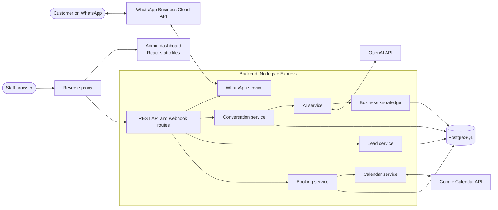
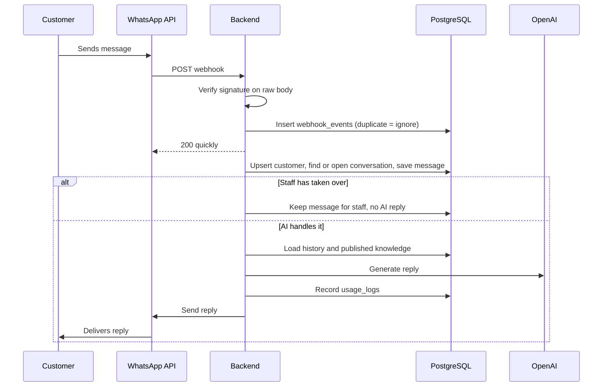
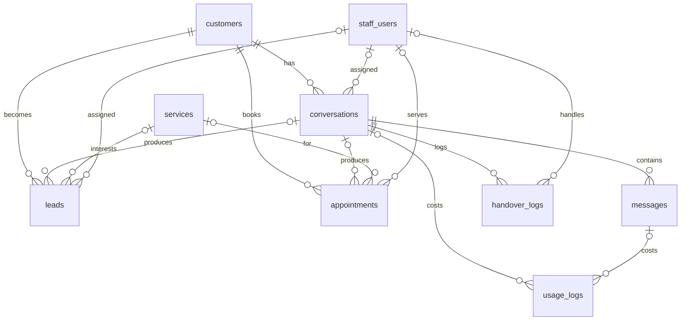

# Architecture

A single Node.js service backed by PostgreSQL, using direct APIs and our own code: no n8n, chatbot builders or CRM platforms.

## System overview

## Components

| Component | Responsibility | Location |
| --- | --- | --- |
| WhatsApp communication | Verify webhooks, send text and templates | `backend/src/services/whatsapp` |
| Backend API | Routing, validation, response format, errors | `backend/src/routes`, `controllers`, `middleware` |
| AI service | Turn history and knowledge into a reply or a handover request | `backend/src/services/ai` |
| Business knowledge | Hours, policies and services the AI may state | `business_info` and `services` tables |
| PostgreSQL | System of record and last line of defence for data rules | `database/` |
| Google Calendar | Availability and booking events | `backend/src/services/calendar` |
| Admin dashboard | Staff view of all of the above | `frontend/` |

## Status: implemented, pending, mock

| Area | Status | Notes |
| --- | --- | --- |
| Express API, health checks, validation, errors | **Implemented, tested** | |
| Read endpoints for conversations, leads, appointments, business info, usage | **Implemented, tested** | Tested on PostgreSQL 18.6 |
| Database schema and migration runner | **Implemented, tested** | |
| Staff login, sessions, admin and agent roles | **Implemented, tested** | scrypt password hashes, server-side sessions |
| Business information and services management | **Implemented, tested** | Admins edit from the dashboard, stored in PostgreSQL |
| Dashboard pages | **Implemented, verified in a browser** | Business Information and Services are editable; the rest are read-only |
| Lead capture and status updates | Pending | Placeholder returns `INTEGRATION_PENDING` |
| Availability, booking, rescheduling, cancelling | Pending | Same |
| WhatsApp, OpenAI, Google Calendar | **Pending, not connected** | Interfaces only; no network calls exist |
| Staff management in the dashboard, password change | Pending | Use `npm run staff:create` and `npm run staff:reset-password` for now |
| Mock functionality | **None in the app** | Test fixtures exist only in `backend/test` and are removed after use |

Placeholders throw instead of returning fake results, and `GET /api` reports `connected: false` for every integration, even when credentials are present.

## Planned inbound message flow (not built yet)

## Data model

`business_info` and `webhook_events` stand alone.

## Key decisions

| Decision | Why |
| --- | --- |
| Data rules live in the database | Two webhook deliveries can race, and only the database sees both. Enforced there: unique phone, WhatsApp message and calendar event IDs; one live conversation per customer; `ends_at > starts_at`; no overlapping live bookings for a staff member. |
| Webhook inbox table | Meta retries deliveries, so a unique `(source, external_event_id)` makes repeats harmless. It also lets us acknowledge quickly and process afterwards. |
| Plain SQL with `pg` | Small query surface, and the migrations are the schema. |
| `dataState` in responses | "No database" and "no customers" must look different to staff. See [api-design.md](api-design.md). |
| Native Node 24 TypeScript in development | No `ts-node`, `tsx` or `dotenv` needed. Production runs compiled JavaScript from `dist/`. |
| Server-side sessions, no JWT | Logout and deactivation take effect immediately, and no signing secret is needed. Only a hash of each token is stored. |
| scrypt from `node:crypto` | A memory-hard password hash with no new dependency. Cost settings are stored with each hash, so they can be raised later. |
| Profile stored in `business_info` | It is the table the AI will read from, so no migration or second source of truth is needed. Working hours are free text for now. |
| Dates stored as `timestamptz` | The business timezone is applied at display and booking time. |

## Known limits to address

- **Login rate limits are in memory.** They reset on restart and assume one API process. Move them to PostgreSQL before running several instances.
- **Hashing uses memory.** Each password check takes about 134 MB for a moment. Check this against the server size when hosting is chosen.
- **`/api/health/database` needs a session.** External monitors can only use `/api/health` until a monitoring approach is chosen at deployment.
- **Working hours are free text.** Booking will need a structured schedule on Day 6.
- **Webhook signatures need the raw body.** `express.json()` discards it, so the webhook route must use its own raw parser, mounted before the JSON middleware.
- **The overlap rule covers staff-assigned bookings only.** If the business books without assigning staff, appointments with no `staff_id` are unchecked and availability logic must cover them.
- **Personal data.** Messages and phone numbers are stored indefinitely. Deleting a customer cascades to their conversations, messages, leads and appointments, but a retention policy is still to be decided.
